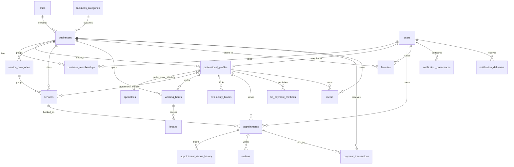

# TurnoYa — Database Design

PostgreSQL 18. All timestamps are `timestamptz` in UTC; presentation uses
`businesses.timezone` (default `America/Bogota`). All money is `unsignedBigInteger` cents,
currency fixed to `COP` at launch.

## 1. Entity relationships



## 2. Tables

### 2.1 Identity

**users** (extends the starter kit)

| Column | Type | Notes |
|---|---|---|
| id | bigserial PK | |
| name, email, password | standard | email unique |
| phone | varchar(30) null | E.164-ish, stored as given |
| document_type | varchar(10) null | CC, CE, NIT, PP |
| document_number | text null | encrypted at rest (Laravel cast) |
| birth_date | date null | |
| avatar_path | varchar(255) null | |
| is_platform_admin | boolean default false | never grants business data by itself |
| is_active | boolean default true | |
| last_login_at | timestamptz null | |
| email_verified_at, two_factor_*, timestamps, softDeletes | standard | |

**notification_preferences**

| Column | Type | Notes |
|---|---|---|
| id | PK | |
| user_id | FK unique | |
| in_app_enabled, email_enabled, push_enabled | boolean default true | |
| reminders_enabled | boolean default true | |
| vacancy_alerts_enabled | boolean default true | global switch |
| marketing_enabled | boolean default false | opt-in only |
| quiet_hours_start, quiet_hours_end | time null | applied to push only |

**notification_deliveries**

| Column | Type | Notes |
|---|---|---|
| id | PK | |
| user_id | FK | |
| business_id | FK null | |
| appointment_id | FK null | |
| channel | varchar(20) | `database`, `mail`, `push` |
| type | varchar(60) | `appointment_reminder`, `vacancy_alert`, … |
| dedupe_key | varchar(191) unique | e.g. `vacancy:{user}:{business}:{slot_start}:{service}` |
| sent_at | timestamptz | |
| failed_at, error | timestamptz, text null | |

**audit_logs**

| Column | Type | Notes |
|---|---|---|
| id | PK | |
| actor_user_id | FK null | |
| business_id | FK null | |
| action | varchar(80) | `membership.role_changed` |
| subject_type, subject_id | morph | |
| metadata | jsonb | before/after, never secrets |
| ip, user_agent | varchar | |
| created_at | timestamptz | no updates |

**idempotency_keys**

| Column | Type | Notes |
|---|---|---|
| id | PK | |
| user_id, key, route | | unique together |
| request_hash | char(64) | detects key reuse with different payload |
| response_status | smallint | |
| response_body | jsonb | |
| expires_at | timestamptz | purged by scheduler |

### 2.2 Business

**cities**: id, name, department, slug unique, center_lat/lng (decimal 10,7),
radius_km (smallint), timezone, is_active, sort_order.

**business_categories**: id, name, slug unique, description, icon (string key), sort_order,
is_active. Seeded with real categories; extensible from the admin panel.

**businesses**

| Column | Type | Notes |
|---|---|---|
| id | PK | |
| city_id, category_id | FK | |
| name, slug | varchar | slug unique |
| tagline, description | varchar(160), text | |
| logo_path, cover_path | varchar null | denormalised from media for fast lists |
| address_line, neighborhood | varchar | |
| latitude, longitude | decimal(10,7) | required; must fall inside city geofence |
| phone, whatsapp, email, instagram, website | varchar null | |
| timezone | varchar(64) | default city.timezone |
| price_level | smallint 1..4 | |
| is_published | boolean default false | |
| is_demo | boolean default false | UI badge |
| published_at | timestamptz null | |
| rating_avg | decimal(3,2) default 0 | approved reviews only |
| reviews_count | unsigned int default 0 | |
| favorites_count | unsigned int default 0 | |
| min_price_cents | unsigned bigint null | denormalised for filters |
| settings | jsonb | booking/payment policy, see below |
| timestamps, softDeletes | | |

Indexes: `(city_id, is_published)`, `(category_id, is_published)`, `slug unique`,
`(rating_avg desc)`, GIN on `to_tsvector('spanish', name || ' ' || description)` (Phase 3).

`settings` shape (validated by a DTO, not free-form):

```json
{
  "slot_interval_minutes": 15,
  "min_lead_minutes": 60,
  "max_horizon_days": 60,
  "payment_policy": "none | deposit | full",
  "deposit_percent": 30,
  "hold_minutes": 15,
  "cancellation_window_hours": 24,
  "late_cancellation_fee_percent": 0
}
```

**business_memberships**

| Column | Type | Notes |
|---|---|---|
| id | PK | |
| business_id, user_id | FK | unique together |
| role | varchar(20) | `owner`, `admin`, `professional` |
| status | varchar(20) | `invited`, `active`, `suspended`, `revoked` |
| can_manage_business, can_manage_team, can_view_finances, performs_services | boolean | |
| invited_by_id, invited_email, invitation_token | | token hashed |
| accepted_at, revoked_at | timestamptz null | |

Indexes: `(user_id, status)`, `(business_id, role, status)`.

**professional_profiles**

| Column | Type | Notes |
|---|---|---|
| id | PK | |
| business_id | FK | |
| user_id | FK null | null until the invited person accepts |
| display_name (unique per business), slug (global unique) | varchar | |
| headline, bio | varchar(160), text | |
| avatar_path, cover_path | varchar null | |
| years_experience | smallint null | |
| is_public, is_accepting_bookings | boolean default true | |
| is_demo | boolean default false | |
| rating_avg, reviews_count | | approved reviews only |
| timestamps, softDeletes | | |

Unique: `(business_id, user_id)` when `user_id` is not null.

**specialties**: id, name, slug unique, sort_order, is_active.
**professional_specialty**: professional_profile_id, specialty_id (composite PK).

**service_categories**: id, business_id, name, sort_order. Unique `(business_id, name)`.

**services**

| Column | Type | Notes |
|---|---|---|
| id | PK | |
| business_id, service_category_id | FK | category nullable |
| name, slug | varchar | unique per business |
| description | text null | |
| duration_minutes | smallint | 5..480 |
| buffer_minutes | smallint default 0 | cleaning/prep |
| price_cents | unsigned bigint | |
| is_active, sort_order | | |
| timestamps, softDeletes | | |

**professional_service**: id, professional_profile_id, service_id, price_cents null,
duration_minutes null, is_active. Unique pair. Null override = inherit service value.

**media** (polymorphic)

id, mediable_type, mediable_id, collection (`logo`,`cover`,`gallery`,`portfolio`,`avatar`),
kind (`image`,`video`), disk, path, thumb_path, poster_path, width, height,
duration_seconds, size_bytes, mime, alt_text, status (`pending`,`approved`,`rejected`),
sort_order, is_demo, timestamps.
Index `(mediable_type, mediable_id, collection, sort_order)`.

**favorites**: id, user_id, business_id, notify_on_vacancy boolean default true,
created_at. Unique `(user_id, business_id)`.

### 2.3 Scheduling

**working_hours**: id, owner_type/owner_id (business or professional), weekday 0..6,
start_time, end_time, valid_from, valid_to, is_active.
Constraint `start_time < end_time`. Overlaps prevented in the application (a schedule
normalisation action), because "recurring weekly" ranges are not trivially expressible as an
exclusion constraint.

**breaks**: id, working_hours_id, start_time, end_time, label.

**availability_blocks**: id, professional_profile_id, starts_at, ends_at, reason,
created_by, timestamps. Used for holidays, personal time, temporary unavailability.

### 2.4 Booking

**appointments**

| Column | Type | Notes |
|---|---|---|
| id | PK | |
| code | char(10) unique | human reference, e.g. `TY-8F3K2Q` |
| business_id, professional_profile_id, service_id, customer_id | FK | |
| starts_at, ends_at | timestamptz | ends = start + duration |
| blocked_until | timestamptz | ends + buffer; the range protected by the constraint |
| status | varchar(24) | see state machine |
| price_cents | unsigned bigint | snapshot at booking time |
| currency | char(3) default 'COP' | |
| payment_policy | varchar(16) | snapshot |
| payment_due_cents | unsigned bigint default 0 | |
| held_until | timestamptz null | only for `pending_payment` |
| customer_notes | text null | |
| cancellation_reason, cancelled_by, cancelled_at | | |
| attendance_confirmed_at, completed_at, no_show_at | | |
| reminder_sent_at | timestamptz null | atomic claim |
| created_by | FK users | customer or staff |
| timestamps, softDeletes | | never hard-deleted |

Indexes: `(professional_profile_id, starts_at)`, `(business_id, starts_at)`,
`(customer_id, starts_at desc)`, `(status, starts_at)`.

**The concurrency constraint** (created in the booking migration):

```sql
CREATE EXTENSION IF NOT EXISTS btree_gist;

ALTER TABLE appointments ADD CONSTRAINT appointments_no_overlap
EXCLUDE USING gist (
  professional_profile_id WITH =,
  tstzrange(starts_at, blocked_until, '[)') WITH &&
) WHERE (status IN ('pending_payment', 'confirmed', 'attendance_confirmed', 'completed'));
```

Notes:
- `completed` is included because historical rows must keep their range occupied even if a
  late record is inserted.
- Expired holds must be transitioned out of `pending_payment` before the slot can be reused;
  the scheduler does this every minute, and the booking action also cleans up expired holds
  for the target range inside the transaction.

**appointment_status_history**: id, appointment_id, from_status, to_status, actor_user_id
null, reason, metadata jsonb, created_at. Append-only.

### 2.5 Payments and tips

**payment_transactions**: id, appointment_id, business_id, provider (`wompi`), provider_id
unique, reference unique, amount_cents, currency, status (`pending`,`approved`,`declined`,
`voided`,`error`), method (nequi, card, pse, bancolombia_transfer, qr), payload jsonb,
verified_at, idempotency_key, timestamps.

**tip_payment_methods**: id, professional_profile_id, type (`nequi`,`daviplata`,
`bancolombia`,`nu`,`bre_b`,`link`,`other`), label, account_holder, account_value (phone,
key or URL — no credentials), qr_path, instructions, is_visible, sort_order.
Unique `(professional_profile_id, type, account_value)`.

### 2.6 Reviews

**reviews**: id, appointment_id, business_id, professional_profile_id null, customer_id,
rating tinyint 1..5, service_quality tinyint null, punctuality tinyint null,
comment text null, status (`pending`,`approved`,`rejected`), moderated_by, moderated_at,
moderation_note, timestamps.
Unique `(appointment_id, business_id)` and `(appointment_id, professional_profile_id)` via
two partial unique indexes (PostgreSQL treats NULLs as distinct, so the second index must
use `WHERE professional_profile_id IS NOT NULL`).

**review_reports**: id, review_id, reporter_id, reason, details, status, resolved_by,
resolved_at.

## 3. Deletion strategy

| Entity | Strategy |
|---|---|
| users | soft delete; anonymise PII on verified deletion request, keep financial rows |
| businesses | soft delete; public routes 404; appointments retained |
| professional_profiles | soft delete; appointments retained with the FK |
| services | soft delete; appointments keep a price/duration snapshot |
| appointments, payments, reviews, audit logs, status history | **never deleted** |

Foreign keys use `restrictOnDelete` where history matters, `cascadeOnDelete` only for
owned, non-historical children (e.g. `breaks` → `working_hours`, `media` → owner).

## 4. Invariants

1. `starts_at < ends_at <= blocked_until`.
2. `ends_at = starts_at + service duration` at creation time (snapshot).
3. No two active appointments overlap for the same professional (DB constraint).
4. A review requires `appointments.status = completed` and `customer_id = reviews.customer_id`.
5. `favorites` is unique per user/business.
6. `notification_deliveries.dedupe_key` is unique.
7. `businesses` coordinates must fall inside an active city geofence (validated server-side).
8. Money columns are never negative.
